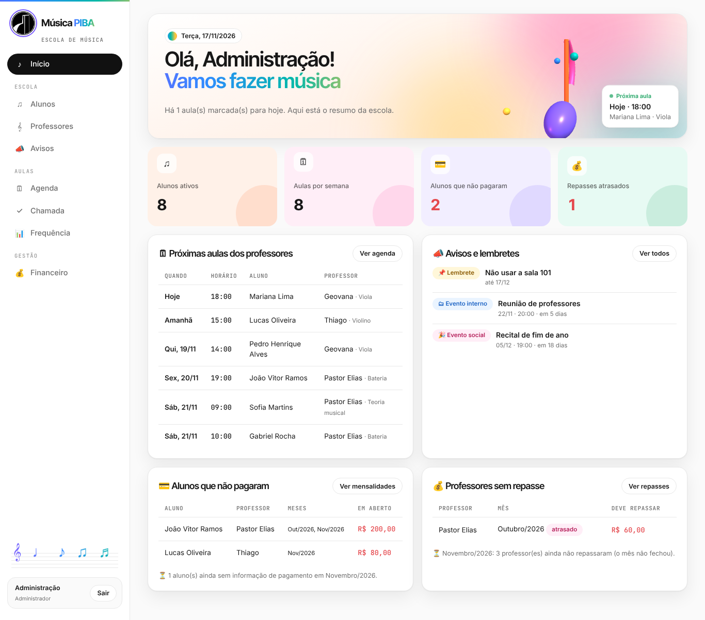

# 🎵 Música PIBA – EscolaPIBA

Sistema web de gestão da **Escola de Música comunitária da PIBA**, para a **administração (secretaria)** e os **professores**:

- 👩‍🎓 **Alunos:** cadastro completo, ficha individual e matrícula com professor, dia, horário e mensalidade
- 🎻 **Professores:** cada um com o próprio **login** e as suas **especialidades** (violino, viola, teoria musical, bateria…)
- 🗓 **Agenda semanal:** cada professor vê as aulas da semana dele; o admin vê a de todos
- ✓ **Chamada:** o professor marca presença ou falta em cada aula; o admin só consulta (presentes, faltas e chamadas não feitas)
- 📊 **Frequência:** percentual de presença por aluno, com alerta abaixo de 75%
- 💰 **Gestão → Financeiro** (três abas): **resumo do mês**, **mensalidades dos alunos** (o professor informa quem pagou) e **repasses dos professores** à escola
- 🎁 **Aulas bancadas pela igreja:** teoria musical e prática de orquestra são gratuitas, e o aluno de instrumento pode ser **bolsista**. Nenhum dos dois entra na cobrança
- 🏠 **Um painel para cada perfil:** o admin vê as próximas aulas de todos, avisos, alunos que não pagaram e professores sem repasse; o professor vê as aulas dele, avisos, mensalidades em aberto e alunos com frequência baixa
- 📣 **Avisos:** o administrador publica eventos sociais, eventos internos e lembretes (ex.: "não usar a sala 101"); todos veem e o painel mostra os próximos

Desenvolvido por **João** como parte do **Projeto de Extensão II – Ação e Difusão Cultural**, curso de Ciência da Computação (Anhanguera).



## Como rodar

1. Instale o **PHP 8** (por exemplo pelo [XAMPP](https://www.apachefriends.org/pt_br/)) e confira se a extensão `pdo_sqlite` está ativa no `php.ini`.
2. Baixe o repositório:
   ```
   git clone https://github.com/Jldiass/EscolaPIBA.git
   cd EscolaPIBA
   ```
3. Inicie o servidor:
   ```
   php -S localhost:8000
   ```
4. Abra http://localhost:8000

Na primeira execução o banco `database/escola.sqlite` é criado sozinho, com dados de demonstração.

### Logins de teste (senha de todos: `piba123`)

| Login | Perfil | O que vê |
|---|---|---|
| **`admin`** | **Administrador** | **Tudo**: cadastra alunos, professores e outros administradores, faz matrículas, publica avisos, acompanha as chamadas e a frequência (só consulta) e cuida do financeiro |
| `thiago` | Professor de Violino | Só os alunos, a agenda, a chamada e as mensalidades dele |
| `geovana` | Professora de Viola | Só os alunos e a agenda dela |
| `elias` | Pastor Elias, Ministro de Música: Teoria musical e Bateria | Só os alunos dele, separados por especialidade |

> ⚠️ Antes de usar de verdade na escola: apague o arquivo `database/escola.sqlite` de demonstração, entre como `admin` e troque a senha em **Professores → Administradores → Editar**. As senhas dos professores também são definidas e trocadas pelo admin, em **Professores → Editar**.

## Tecnologias

| Camada | Tecnologia |
|---|---|
| Telas | HTML5 + CSS3 (sem framework) + JavaScript |
| Animação 3D do painel | Three.js r128 (guardado em `assets/js/vendor`, funciona sem internet) |
| Lógica no servidor | PHP 8 |
| Banco de dados | SQLite, acessado com PDO |
| Login | Sessão PHP + senhas com `password_hash` |

## Documentação

- 📘 [Documentação do sistema](docs/DOCUMENTACAO.md): requisitos, perfis, regras de negócio, banco de dados e telas
- 🧑‍💻 [Como o código funciona](docs/COMO-O-CODIGO-FUNCIONA.md): explicação de cada arquivo, segurança e exercícios

## Privacidade (LGPD)

Os **alunos** do repositório são **fictícios**. Os dados reais ficam só no arquivo do banco, no computador da escola, que nunca vai para o GitHub (`.gitignore`). Cada professor só enxerga os próprios alunos.
