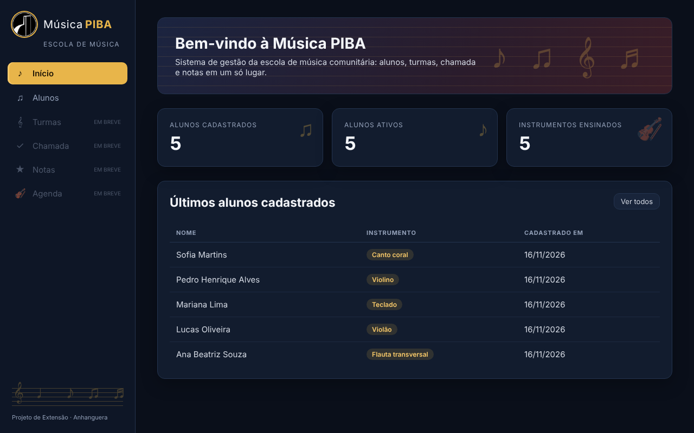

# 🎵 Música PIBA – EscolaPIBA

Sistema web de gestão da **Escola de Música comunitária da PIBA**: alunos, turmas, chamada (frequência), notas com média automática, boletim e agenda de apresentações.

Desenvolvido por **João** como parte do **Projeto de Extensão II – Ação e Difusão Cultural**, curso de Ciência da Computação (Anhanguera).



## Tecnologias

| Camada | Tecnologia | Por quê |
|---|---|---|
| Telas | HTML + CSS | Simples, roda em qualquer navegador e no celular |
| Lógica | PHP 8 | Linguagem de servidor estudada no curso |
| Banco de dados | SQLite (via PDO) | Um único arquivo, não precisa instalar servidor de banco |

## Como rodar no seu computador

1. Instale o PHP 8 (por exemplo pelo [XAMPP](https://www.apachefriends.org/pt_br/)) e confira se a extensão `pdo_sqlite` está ativa no `php.ini`.
2. Baixe este repositório (`git clone https://github.com/Jldiass/EscolaPIBA.git`).
3. Dentro da pasta, rode:
   ```
   php -S localhost:8000
   ```
4. Abra http://localhost:8000 no navegador.

Na primeira execução o banco `database/escola.sqlite` é criado sozinho, com **alunos fictícios** para demonstração.

## Estrutura de pastas

```
EscolaPIBA/
├── index.php            Painel inicial (números da escola)
├── alunos/              Cadastro de alunos (listar, criar, editar, excluir)
├── config/database.php  Conexão com o banco SQLite
├── includes/            Topo (menu lateral) e rodapé, usados em todas as páginas
├── assets/              CSS e imagens (logo da PIBA)
├── sql/                 Criação das tabelas e dados fictícios
├── database/            Onde o arquivo do banco é gerado (não vai para o GitHub)
└── docs/                Explicação de cada etapa do desenvolvimento
```

## Etapas do desenvolvimento

- [x] **Etapa 1** – Estrutura, visual e cadastro de alunos ([explicação](docs/ETAPA-1.md))
- [ ] Etapa 2 – Turmas e matrícula de alunos
- [ ] Etapa 3 – Chamada / frequência
- [ ] Etapa 4 – Notas, média automática e boletim
- [ ] Etapa 5 – Agenda de apresentações e relatório de impacto

## Privacidade

O repositório contém **apenas dados fictícios**. Os dados reais dos alunos ficam somente no arquivo do banco, no computador da escola, e nunca são enviados ao GitHub (`.gitignore`).
